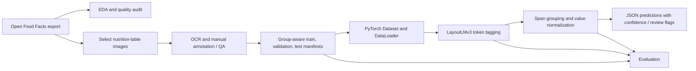

# Product Nutrition Facts Extraction — Reproducible Prototype

> **Assessment note:** The included EDA notebooks use a 50,000-row sample from the Open Food Facts English compressed TSV export. Results describe only this top-of-file sample; the live export changes. Product-level metadata is not image-grounded model truth.

## Current workflow — documentation verified 2026-10-30

Start with the cache-only [Dashboard2 guide](app_final_README.md), or open the
[offline Dashboard2 snapshot](main_output/index.html).
The original [app.py](app.py) is protected and **was not altered** by this
documentation update. No Python, notebooks, data, models or scripts were edited;
no model, installation, inference or server was run for this review.

### Keep the populations separate

| Source / purpose | Saved population | Interpretation |
|---|---:|---|
| [Enriched EDA sample](data/openfoodfacts_eda_enriched.csv) | 50,000 rows, 44 fields | First-row, non-random sample; default product EDA, not the complete export |
| [Complete-source scan](outputs/part1_part2_integration/full_scan_summary.json) | 4,881,991 rows; 4,881,935 unique barcodes | Disk-backed EOF scan of the saved complete product snapshot |
| [Linked integration](outputs/part1_part2_integration/data_dictionary.md) | 3,075 matched products/images | Exact barcode linkage to that complete snapshot, **not to the 50K sample**; no packaging-identity guarantee |
| [Official annotation inventory](part2/README.md#dataset-and-annotations) | 3,083 images: 2,884 train + 199 test | Includes eight unmatched images; original OCR words, boxes and gold BIO labels preserved |
| Full matched inference target | 3,075 images: 2,876 train + 199 test | Fixed target; completed-image scores are partial until all targets succeed |
| [Seeded evaluation](reports/part2/bio_pipeline_findings.md) | 20 official-test images, seed 42 | Separate saved rules/model comparison; not the full cohort or an independent OCR benchmark |

The [earlier zero-overlap report](reports/dataset_overlap_analysis.md) remains
correct **for the 50K sample only**. Later full-source linkage does not invalidate
that result or make sample metadata image-grounded truth.

### Choose the interface

| Interface | Role | Limits |
|---|---|---|
| [Original app](app.py), port **8501** | Original broader exploration and explicit inference actions | Preserved; cached browsing and opt-in processing must not be confused |
| [Final app](app_final.py), port **8502** | Read-only/cache-only, eight sections, **View Raw Data first** | No OCR, model loading, training, inference, image fetching or weight downloads |
| [Offline Dashboard2](outputs/presentation/dashboard2_README.md) | Eight-section embedded HTML from the clean app's actual render functions | No country/category EDA filters, uploads, live refresh or inference; embedded plots remain interactive |
| [Original seven-section demo](outputs/presentation/README.md) | Separate optional compatibility presentation downloaded by the original app | Not Dashboard2 and not automatically obsolete |

Clean navigation: View Raw Data → Data Overview → Data Understanding → Nutrients
→ Data Quality → Part 2 Dataset Info → BIO Entity Tagging → Results.
Product filters use OR within country/category and AND between dimensions.
Without filters, Part 2 shows all 3,083 original images regardless of the product
dataset; with filters it intersects exact barcode strings. Evaluation membership,
targets and saved scores do **not** change with product filters.

### Charts and approach explanations

- **Histogram / box / violin:** frequency ranges, middle-half/spread/outliers,
    and density respectively. All finite observations, zeros and extremes stay in
    scope; no clipping or imputation. Nutrient tables explain average, median,
    standard deviation, quartiles and all tied modes; all-unique data has no repeated mode.
- **Pearson correlation:** pairwise complete observations, at least three pairs;
    blank cells can mean insufficient data or variation. Association is not cause,
    correctness or improved BIO accuracy. Live selection defaults to six fields;
    offline HTML embeds the full available matrix, without correlation subsetting.
- **Data quality:** missing/blank fields, repeated barcode/row counts, invalid
    numbers, negatives, IQR flags and named gram-based per-100-g bounds are review
    signals, not instructions to repair or delete values. Source units/bases remain.
- **Fixed 50K examples** are explicitly separate from filtered charts. The
    source-specific examples include `energy_100g` (kJ per 100 g, or 100 ml for
    liquids) median 1,350 and maximum 680,000,
    carbohydrates median 25.5 with 7,857 values above 100, and energy-field
    correlation about 0.8307 on 47,748 pairs. They must not be generalized to the
    full export or confused with different energy units/fields in historical reports.
- **How the Methods Were Compared:** rules and the pretrained LayoutLMv3 use the
    same frozen 20 official-test images, OCR words, boxes and projected gold.
    **Basic Nutrient Detection** compares shared `VALUE` / `BASIS` / `O` spans;
    annotated serving-size groups become `BASIS`, nutrient values become `VALUE`.
    An ordinary OCR phrase such as per100g is not automatically a gold basis span.
    **Detailed Nutrient Identification** is a separate model-only nutrient/basis
    task, not a fair direct comparison against coarse rule labels. No model was retrained.
- **Understanding the Results:** exact entity type and word boundaries must
    match. Micro precision/recall/F1 pool counts, not per-image F1 averages. Token
    accuracy includes O and can mask missed entities. Train/test stay separate;
    train is descriptive, not held-out generalization. Supplied-OCR BIO results
    are neither OCR accuracy nor proof of correct numeric fields/package truth.

### Full-cohort checkpoint and safe resume

At **2026-10-30T15:01:33.063231+00:00**, the saved
[summary](outputs/full_cohort_bio/summary.json) says **paused_model_load_error**:
**441 completed (195 test, 246 train), 1 failed, 2,633 pending / 3,075 target**.
This is a published checkpoint, **not evidence of an active worker**. Pending
and failed images stay in coverage denominators but are not scored as zero.
Inspect the saved [failures](outputs/full_cohort_bio/failures.json) before resuming.

The Windows [full-cohort runner](scripts/full_cohort_bio.py) uses a single-worker
lock, source fingerprints, schema-checked per-image checkpoints and atomic
publication. Re-running it resumes compatible completed samples; failed and
unprocessed records are retried. `--limit` caps **new attempts**, not the target.
It loads the existing local CPU ONNX model only when required. Initial ONNX
loading needs **2.5 GiB available RAM**; the per-attempt continuation gate is
**0.75 GiB**, intended for the resident session, not permission to load below
2.5 GiB. Local Transformers fallback requires 6 GiB. No model weights are
downloaded. Missing/expired image links can still require official row/image
network access; this runner is not an offline-only process.

After resolving resource/load errors, an explicitly requested bounded resume is:

```powershell
python scripts/full_cohort_bio.py --limit 1
```

Omit the limit only for an intentional longer resume. Do not start a second
worker or delete locks/caches to force progress. The seeded-20 cache remains a
distinct reproducible comparison, not replaced by this larger model-only run.

### Notebook and export refresh

1. [EDA notebook](eda_openfoodfacts.ipynb): sample-level profiling and saved EDA tables.
2. [Integration notebook](part1_part2_dataset_integration.ipynb): complete-source
     barcode scan and normalized products/images/original annotations.
3. [Preprocessing notebook](part2_preprocessing_eda.ipynb): pre-inference readiness;
     keep its original 25-image pixel convenience sample distinct from all-image token audits.
4. [Impact notebook](part1_eda_impact_on_part2.ipynb): observational metadata/error
     analysis using its declared seeded prediction cache, not live full-cohort scoring.
5. [BIO notebook](part2/part2_layoutlm_bio_tagging.ipynb): seeded inference/review
     plus appended full-cohort checkpoint display/validation. Re-execute only the
     saved-artifact display cells to refresh output; do not Run All just to update
     a status table, since inference/network cells are opt-in. Saved cell outputs
     remain snapshots until explicitly refreshed. No notebooks were refreshed here.
6. [Dashboard2 exporter](scripts/export_final_dashboard.py) embeds local charts,
     results, downloads and thumbnails from the actual clean render functions.
     Re-export only when a new HTML snapshot is wanted; it does not refresh notebook
     output, run inference or update source artifacts. See its
     [runtime dependencies and limitations](outputs/presentation/dashboard2_README.md#regeneration-and-validation).

Historical/generated Markdown below and under reports/outputs retains original
measurements and dated test statements, **not a newly verified suite total**.
See [cleanup review](docs/cleanup_review.md) for conditional proposals; nothing
has been deleted or moved. Parent assignment/case-study documents outside this
project remain unchanged.

## Objective

Given a product nutrition-table image, detect and extract structured entities such as nutrient names, values, units, and serving references. The proposed approach uses OCR to obtain words and their positions, then a layout-aware token classifier (LayoutLMv3) to label entities. A deterministic post-processing layer groups tagged spans into candidate records. Product metadata is used for EDA and quality checks; it is **not** treated as proof that a value is visible in the selected image.

## Pipeline



## Repository layout

- `configs/base.yaml` — label vocabulary, paths, split policy, and training parameters.
- `src/nutrition_extraction/eda.py` — raw-export profiling; writes machine-readable report tables.
- `src/nutrition_extraction/acquire.py` — bounded download of product text, image references, and core nutrition fields.
- `src/nutrition_extraction/preprocessing.py` — shared image/text normalization.
- `src/nutrition_extraction/ocr.py`, `extraction.py` — replaceable OCR interface and executable lexical/spatial baseline.
- `src/nutrition_extraction/evaluation.py`, `schema.py` — OCR/entity/record metrics and typed JSON output contract.
- `src/nutrition_extraction/dataset.py` — annotation manifest reader and PyTorch dataset/collator.
- `src/nutrition_extraction/model.py` — LayoutLMv3 model construction and training loop.
- `src/nutrition_extraction/metrics.py` — token/entity metrics and normalized field accuracy helpers.
- `src/nutrition_extraction/inference.py` — OCR, token tagging, and span extraction.
- `src/nutrition_extraction/splitting.py` — deterministic group-aware split creation.
- `src/nutrition_extraction/train.py`, `evaluate.py`, `predict.py` — entrypoints.
- `eda_openfoodfacts.ipynb` — reproducible notebook; bounded image audit, plots, sample-specific observations, and opt-in model/OCR sections.
- `tests/` — unit tests for EDA, splits, normalization, and metrics.

## Data and annotation contract

The EDA accepts a tab-separated or comma-separated Open Food Facts export (`.csv`/`.tsv`), JSON array, or JSON Lines file. Open Food Facts exports vary by version and selected columns; inspect headers and configure fields based on the actual file.

The model requires **image-grounded token annotations**. One JSON object per line in each split manifest:

```json
{"product_id":"example-001","image_path":"data/images/example-001.jpg","words":["Energy","200","kcal","Fat","8","g"],"boxes":[[20,30,160,70],[170,30,230,70],[235,30,300,70],[20,90,90,130],[170,90,200,130],[205,90,235,130]],"tags":["B-NUTRIENT","B-VALUE","B-UNIT","B-NUTRIENT","B-VALUE","B-UNIT"]}
```

Coordinates use the LayoutLM convention (integers from 0 to 1000). Tags use BIO labels from `configs/base.yaml`. Keep OCR words, boxes, and tags aligned. Create labels by annotation or carefully audited weak supervision; product-level nutrition metadata alone cannot establish which image/table text corresponds to which field.

## Setup

Use Python **3.10–3.12** (`>=3.10,<3.13` in [pyproject.toml](pyproject.toml)).
Choose only the extras needed for the workflow; cached dashboard browsing does
not require training/OCR extras or weights. Base dependencies include pandas,
Pillow, PyYAML, scikit-learn, NumPy, matplotlib and seaborn. The `dashboard` extra
adds Streamlit/Plotly, but **PyArrow is separately required** for linked Parquet
reads and **Markdown is separately required** for Dashboard2 export; neither is
declared by that extra. Reuse an existing compatible environment where possible.
The optional `bio-inference`, `easyocr`, `ocr`, `paddleocr`, `image-audit`, `train`
and `test` extras have distinct roles. Tesseract also needs its native executable.
The commands below are documentation examples, not commands executed in this update.

```powershell
py -m venv .venv
.\.venv\Scripts\Activate.ps1
python -m pip install --upgrade pip
python -m pip install -e ".[dashboard,test]"
python -m pip install pyarrow Markdown
```

## Run the EDA first

```powershell
nutrition-eda --input data\openfoodfacts_eda_enriched.csv --output reports\eda
```

It creates `summary.json`, `missingness.csv`, and `nutrition_coverage.csv`. Review image coverage, nutrition-label completeness, duplicate products, countries/languages/categories, and label imbalance. Record observed values and decisions in your final report; do not copy illustrative assumptions as results.

Or open `eda_openfoodfacts.ipynb` in VS Code and run its cells from the top. It downloads at most 50,000 rows if the cache is absent, saves the compressed-source sample to `data/`, writes EDA artifacts to `reports/eda/`, and audits only the configured small sample of nutrition image URLs. Model weights and bulk image downloads are not triggered.

For the extraction workflow, use `ocr_extraction_workflow.ipynb`. It reviews the refreshed country/serving fields, creates a bounded manual-review queue, includes one visually checked French nutrition panel and row-level transcription, and demonstrates the rule-based tagger using clearly marked synthetic input. Word-level OCR boxes/BIO labels are still needed before model training.

## Interactive Streamlit dashboard

Install the optional dashboard dependencies in the project virtual environment and launch the app from the project root:

```powershell
pip install -e ".[dashboard]"
python -m streamlit run app.py --server.port 8501
python -m streamlit run app_final.py --server.port 8502
```

The original dashboard defaults to the enriched sample, supports CSV/TSV upload
and country/category filtering, and retains broader EDA, common-subset,
image/alignment, annotation-scout and cached BIO/review views. Its EDA report
and filtered records/review queues can be downloaded. EDA browsing does not run
OCR or treat metadata as image gold; **explicit original-app BIO/upload actions
can run local inference/OCR**. The clean app is the separate eight-section,
strictly cache-only interface described above; do not infer its controls from
historical original-app navigation reports. Neither app downloads BIO weights.

## Measured EDA snapshot (refreshed enriched 50,000-row sample)

These are notebook-computed observations from the local sample, not estimates for the complete Open Food Facts database:

> **Historical Part 1 snapshot (2026-10-28):** measurements and environment claims
> in this section describe that run. Later Part 2 work added official BIO
> annotations, local pretrained ONNX inference and actual EasyOCR checks; see the
> [Part 2 guide](part2/README.md) and [measured reports](reports/part2/bio_pipeline_findings.md).

- The source schema contains 211 columns; the refreshed sample retains 44 relevant fields including country, product/serving context, image references, and nutrition attributes. It had 50,000 unique product codes, no duplicate codes or exact duplicate rows, and 261 blank product names.
- 47,775 rows (95.55%) have at least one non-missing selected nutrition field. Coverage is 95.50% for energy-kcal, 95.41% fat, 95.37% carbohydrates, 95.37% protein, 91.36% sugars, and 79.07% fiber.
- 13,694 rows (27.39%) have at least one image URL; 8,803 (17.61%) have a nutrition-image URL. These are references only, not confirmation that the panel is legible or aligned to metadata.
- A bounded 10 nutrition-image audit decoded 10/10 images. Width ranged from 192–400 px and height from 74–400 px. This deliberately small audit is not a quality estimate for all images.
- Country labels are strongly US-skewed: 41,212 comma-split label occurrences show “United States”; language variants are separate labels. `serving_size` coverage is 95.2%, and package `quantity` is 64.99%.
- One product nutrition image (product 241013128) was visually reviewed; its per-100-g metadata values matched the panel. This single record is a manual check, not a representative alignment study or model benchmark.
- Main nutrient distributions are strongly right-skewed and contain suspicious values (for example, fat up to 1,000,000 per 100 g and one negative protein and fiber value). Investigate rather than silently clip/delete.
- 12,771 records have any image URL plus at least one selected nutrition value; 8,527 additionally have a nutrition-image URL. Neither count establishes image-to-value alignment.
- No OCR engine ran because neither the Tesseract executable nor PaddleOCR is installed. There are no word-level box/BIO annotations and no trained LayoutLMv3 checkpoint, so no OCR/entity model metrics are reported.

### Why these 47 columns, and what was omitted?

The initial EDA retained a smaller 47-field subset. A refreshed 44-field sample now includes product/serving/country context, available image references, and selected nutrition fields. This is a pragmatic, low-memory EDA subset—not learned feature selection and not a declaration that other fields are irrelevant.

The notebook compares the current sample with the 211-field source header and inventories omitted fields. The current excluded-column inventory is generated at `reports/eda/excluded_source_columns.csv`; its categories change when the selected sample changes.

Nutrition-basis and serving-quantity fields are not present in the current export slice; the image itself must be used to annotate basis. Other omitted data may be important for stratification or a broader nutrient scope.

The notebook stores current computed tables and a manual-review candidate sheet under `reports/eda/`. Re-run it after refreshing the sample; do not treat this dated snapshot as a stable dataset property.

## Prepare splits

Create the annotation JSONL files at the paths configured in `configs/base.yaml`. Split at the product/SKU group level at minimum to prevent duplicate images of the same product crossing splits. If the intended claim is generalization to unseen brands, additionally hold out brands and report that stricter result separately. Freeze the test set before iteration.

```powershell
nutrition-split --input data\annotations.jsonl --output-dir data\splits --group-key product_id --seed 42
```

## Train, evaluate, predict

These are the separate generic scaffold entry points, not the current Part 2
pretrained ONNX/full-cohort workflow. The generic trainer is executable and may
load pretrained assets; it is **not** the no-training placeholder in
[part2/train.py](part2/train.py). No training is claimed to have run. These
commands require project-specific manifests/checkpoints and explicit opt-in.
Install the separate `train` extra only if deliberately using these generic
training/model entry points; the dashboard-only setup does not provide it.

```powershell
nutrition-train --config configs/base.yaml
nutrition-evaluate --config configs/base.yaml --checkpoint artifacts/model
nutrition-predict --config configs/base.yaml --image data\sample.jpg --output reports\sample_prediction.json
```

Inference uses OCR on the supplied image. The prototype returns BIO-tagged spans and normalized text with a confidence score; it is not a production-grade table parser. Review low-confidence or inconsistent nutrient/value/unit associations rather than silently accepting them.

The recommended CPU OCR baseline uses EasyOCR; Tesseract and PaddleOCR adapters
are also available. Use the `easyocr` extra only when OCR is intended. Later
Part 2 measured reports demonstrate actual CPU EasyOCR runs with local weights;
do not infer the current environment from the initial EDA's no-OCR status.
Keep downloads disabled and verify local OCR assets. Only a separately approved
setup may enable `ocr.allow_model_downloads: true`. For the reviewed French
image, configure the language as `fr`.

```powershell
nutrition-ocr-predict --config configs/base.yaml --image data\manual_samples\241013128_nutrition.jpg --output reports\prediction.json --ocr-backend easyocr
```

EasyOCR runs in CPU mode in this baseline. Tesseract still requires its native executable; PaddleOCR is an optional adapter requiring its compatible Windows CPU runtime. The lexical/spatial extraction layer is explicitly a baseline, not a trained classifier or robust table-structure model.

## Scout candidates for manual annotations

Use the annotation scout to build an annotation-review queue from the enriched sample:

```powershell
nutrition-scout-annotations --input data\openfoodfacts_eda_enriched.csv --output-dir reports\annotation_scout --top 500 --pilot-size 100 --per-locale 3
```

On the current 50,000-row sample, it found 8,803 records with a nutrition-image URL and 8,527 with both such a URL and at least one selected structured target. Of the 8,527 candidates, 8,294 have at least seven of the nine target fields and 6,550 have all nine. The URL filename suggests locale hints (mostly `en`, followed by `fr` and `es`); this is only a hint, not reliable language classification.

The scout ranks candidates using target-field completeness plus product-name, brand, country, and serving-size presence. It exports a top-ranked work queue and a 100-record locale-diverse pilot in `reports/annotation_scout/`. It does **not** create annotations, confirm the image contains the right table, or treat metadata as truth. The `alignment_verified` flag stays false except for any product with a separately recorded manual visual review; reviewers should capture status, name, notes, and then annotate OCR words/boxes/BIO tags. Current counts are search-queue sizes, not usable labeled-data counts.

## EDA questions to answer in your own report

1. Which export/date/locale was used, how many rows/products were examined, and what sampling limits apply?
2. What fraction has usable nutrition-table images, product identifiers, and structured nutrition fields?
3. Which target nutrients and units have sufficient, reliable coverage? What is missing or inconsistent?
4. How many duplicate codes/images/near-duplicate products exist? How did you prevent leakage?
5. Which language, country, category, image resolution, and label-coverage imbalances could affect performance?
6. Which records are excluded, and why? What is the expected manual annotation effort?
7. What split is used and what population does the test set represent?

## KPIs

Report per entity and overall, including support counts and confidence intervals where feasible:

- Token-level precision, recall, and F1 (diagnostic only).
- Exact-span entity precision, recall, and F1 by `NUTRIENT`, `VALUE`, `UNIT`, and `SERVING`.
- Normalized field accuracy: nutrient identity plus numeric value/unit after canonicalization and tolerance rules.
- End-to-end row accuracy: all required fields for one nutrient row are correct.
- OCR word error rate / character error rate on a manually transcribed image subset.
- Coverage and abstention rate at a chosen confidence threshold; evaluate selective accuracy vs coverage.
- Latency per image, throughput, and failure rate; optionally memory/model size.

Define numeric tolerance, unit conversions, duplicate-resolution rules, and treatment of rounding **before** evaluating. Never report a metric without its denominator and split definition.

## Known limitations and next steps

- The generic pipeline remains an engineering scaffold; the separate Part 2 pretrained ONNX integration has measured subset results, not production certification. Check API compatibility before explicitly opting into execution.
- OCR and annotation quality are likely major error sources. Keep OCR errors distinct from tagging errors in evaluation.
- Table row association (e.g., nutrient/value columns and per-100g vs per-serving) may require a table-structure model or relation classifier beyond token tagging.
- Add image checksums, licensing/source attribution, data versioning, experiment tracking, calibration, and a human-review workflow before production use.
- A remote Git repository is not created automatically. Create one in your own account, inspect the contents, and push this folder when ready.
- The LayoutLMv3 command downloads pretrained model assets when run; it is intentionally not invoked by the notebook. Confirm available RAM, model licensing, and CPU runtime before opting in.
- The manually reviewed product is `241013128` (Eclairs): its image visibly shows both per-100-g and 90-g portion values, and the per-100-g values agree with the structured record. This single record is not a benchmark. It is saved in `data/evaluation/gold_ocr.txt` and `gold_records.jsonl`; it has no token boxes/BIO tags.
- Initial EDA statements that OCR had not run are historical. The [manual OCR snapshot](reports/part2_ocr_validation/review_summary.md) and [follow-up manual model/rule review](reports/part2/bio_remaining_tasks_findings.md) record later one-image measurements under different runs/scoring conventions; neither establishes general OCR accuracy. No dependencies or weights were inspected by executing models in this documentation review.
