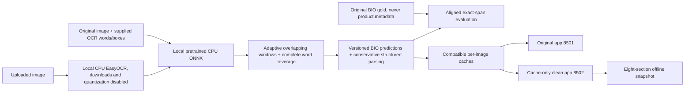
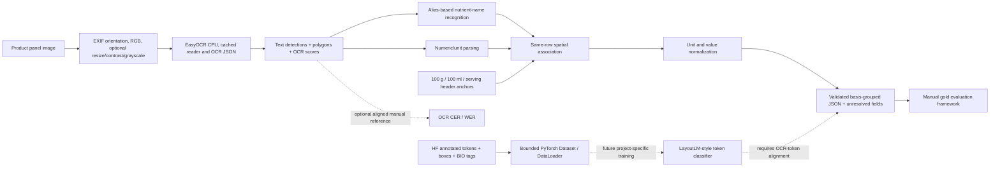

# Part 2 architecture and supervised extension

> **Current architecture context — 2026-10-30.** The rule-based OCR path below
> remains implemented. Local pretrained LayoutLMv3 inference is **also implemented**;
> only project-specific supervised fine-tuning remains proposed. See the
> [module guide](README.md) and [project workflow](../README.md#current-workflow--documentation-verified-2026-10-30).
> This documentation update did not alter either app, code, notebooks or gold.

## Current pretrained and cached-display paths



The [full-cohort runner](../scripts/full_cohort_bio.py) resumes 3,075 matched
images using source fingerprints, atomic checkpoints and a single-worker lock;
it is separate from the seeded-20 fair coarse rules/model comparison. The
[saved summary](../outputs/full_cohort_bio/summary.json) records 441 completed,
1 failed, 2,633 pending and `paused_model_load_error` at
2026-10-30T15:01:33.063231+00:00, not an active worker. Initial local ONNX loading
requires 2.5 GiB available RAM; continuation uses a 0.75 GiB gate. No model
weights are downloaded. Official image/row refreshes can use network access.
Clean dashboard/export paths only read existing artifacts and local thumbnails.

## Implemented inference path



### Component responsibilities

1. **Preprocessing:** applies EXIF orientation, converts to RGB, optionally resizes while preserving aspect ratio, increases contrast mildly, and optionally converts to grayscale. It returns an in-memory copy; cached/source images are not overwritten.
2. **EasyOCR:** CPU-only reader, instantiated once per language/model configuration. Word/line detections are sorted in approximate reading order. An SHA-256 keyed JSON cache avoids repeated OCR. Confidence is retained only as OCR engine confidence; it is not calibrated confidence in an entity association.
3. **Entity and association baseline:** matches conservative multilingual aliases, parses numeric strings/decimal commas/units, groups detections by visual row, and associates a value only on the same row and to the right of a detected nutrient name. If values/bases are ambiguous, the field is unresolved instead of guessed.
4. **Basis and normalization:** basis headers identify per 100 g, per 100 ml, and serving columns. Values are preserved in original value/unit and a canonical companion is recorded (kJ→kcal; mg/µg→g; L→ml). Different bases remain separate.
5. **Structured output:** JSON includes barcode, source image, basis-grouped nutrient lists, unresolved fields, warnings and elapsed time. Multiple values are preserved rather than silently overwritten.
6. **Dataset loader:** requests at most 50 rows from a single official split through the HF dataset-server rows API. It lazily fetches only requested image assets and caches them locally. Train/test split labels are not combined. The loader demo does not use gold labels to tune rules.
7. **Evaluation:** OCR CER/WER requires manually verified transcription; structured metrics require manually verified gold records; BIO span metrics require explicit token alignment. No evaluation score is claimed from the synthetic unit-test fixtures.

## Dataset schema and supervised labels

Inspected against the public repository metadata and dataset card at revision `7d3245ca596f0c8f41dc740ca0fa5987b1e0fd4d`:

- `default/train`: 2,884 rows; `default/test`: 199 rows.
- Top-level features: `ner_tags`, `tokens`, `bboxes`, `image`, `meta`.
- `tokens` and `ner_tags` are sequences; `bboxes` is a sequence of `[x_min, y_min, x_max, y_max]` integer coordinates, nominally 1–1000; `image` is an image feature.
- `meta` includes string `barcode`, `image_id`, `image_url`, `split`, `ocr_url`, plus batch and annotation/review flags.
- `ner_tags` has 71 classes. `part2.dataset.BIO_LABELS` is the metadata class-id mapping. Entity classes identify annotated values and units for nutrient/basis classes; nutrient-name strings are generally outside the annotated entity spans and marked `O`. The task is token classification, not a fully supervised nutrient-name/value row-relation task.
- License: CC-BY-SA 3.0. Attribute and follow the license when redistributing derived samples.

## Proposed supervised training pseudocode — not implemented or executed

```text
READ official train split only for model fitting; reserve validation groups from train
KEEP official test split locked until model/rule choices are frozen
GROUP examples by barcode before any train/validation resplit to prevent image leakage
FOR each example:
    load image and run the project's OCR engine, or consume the provided tokens only
    align the OCR token sequence to annotation tokens (edit-distance / geometry alignment)
    reject or manually adjudicate examples whose word-to-label alignment is uncertain
    normalize each [x0,y0,x1,y1] bbox to the 0..1000 LayoutLM convention and clip bounds
    tokenize OCR words with a LayoutLM processor; propagate word BIO labels to subwords
    set special-token/padding labels to -100 so they do not contribute to loss
INITIALIZE a LayoutLM-family token classifier with the 71 repository labels
OPTIMIZE cross-entropy over aligned BIO labels on CPU with small batches and gradient accumulation
AFTER each epoch, evaluate entity-span P/R/F1 on validation groups and save best checkpoint
AFTER choices are frozen, run the held-out official test split once and report support per class
```

No executable trainer or training run is part of the **Part 2 module**. The
lightweight `python -m part2.train` command prints this status rather than
downloading a checkpoint. This does not describe the separate generic
`nutrition-train` scaffold under the source package, which can load pretrained
assets if explicitly run. The implemented Part 2 predictor loads only local
pretrained weights; inference is not new training.